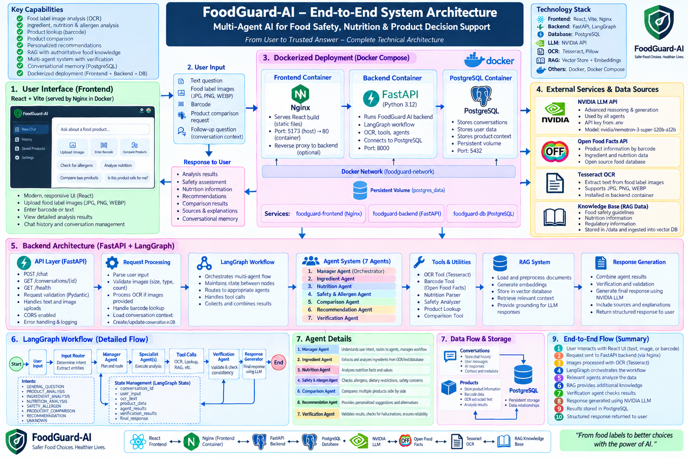
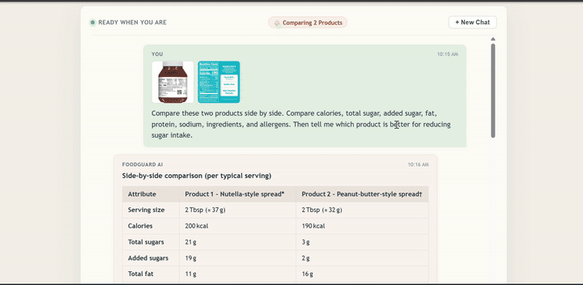

# FoodGuard AI 🥗🤖

### Multi-Agent Food Safety, Nutrition & Product Decision Assistant

FoodGuard AI is a conversational AI application that helps users understand packaged-food products from **text, food-label images, and product barcodes**.

Instead of relying on one large LLM prompt, the system combines:

- **React + Vite** for the user interface
- **FastAPI** for the backend API
- **LangGraph** for multi-agent orchestration
- **NVIDIA LLM API** for reasoning and natural-language generation
- **Specialized agents** for ingredients, nutrition, safety/allergens, comparison, recommendations, and verification
- **Tesseract OCR + Pillow** for food-label image processing
- **Open Food Facts** for barcode/product lookup
- **RAG** for retrieval-grounded food knowledge
- **PostgreSQL** for persistent conversations and application context
- **Docker Compose** for the complete frontend/backend/database deployment

> **Safety boundary:** FoodGuard AI is an educational and product-decision-support application. It does not diagnose medical conditions or provide medical treatment.

---

## 📌 Project Goal

Reading a packaged-food label can be difficult because important information is spread across:

- Ingredients
- Nutrition facts
- Added sugars
- Sodium
- Fat
- Protein
- Allergens
- Cross-contact warnings
- Serving sizes
- Product information

FoodGuard AI turns that information into a **conversational experience**.

A user can ask questions such as:

> "Analyze this product."

> "Are there any allergens?"

> "Explain these ingredients."

> "Compare these two products."

> "Which product has less added sugar?"

> "What does this nutrition label mean?"

The application extracts and validates available information, sends the appropriate evidence through the LangGraph workflow, and returns an understandable answer.

---

# 🏗️ Complete System Architecture



The architecture above shows the complete path from the user's interface to the final response.

---

# 🎥 Project Demo

The uploaded screen recording demonstrates the FoodGuard AI interface and a **two-product image comparison** workflow.

### Demo video


[▶️ Watch the full-quality demo video](docs/foodguard-ai-demo.mp4)

The demonstrated workflow includes:

1. User uploads two product-label images.
2. User asks for a side-by-side comparison.
3. OCR extracts information from the uploaded labels.
4. Each image remains associated with its own product.
5. LangGraph routes the request to the comparison workflow.
6. Product information is normalized.
7. Nutrition and allergen information are compared.
8. The application presents the comparison conversationally.

---

# 🔄 End-to-End Request Flow

Here is the complete flow in simple terms:

```text
                         USER
                          │
                          ▼
                ┌───────────────────┐
                │ React + Vite UI   │
                │ Text / Image /    │
                │ Barcode / Chat    │
                └─────────┬─────────┘
                          │
                          ▼
                ┌───────────────────┐
                │ Nginx Frontend    │
                │ Docker Container  │
                └─────────┬─────────┘
                          │
                          ▼
                ┌───────────────────┐
                │ FastAPI Backend   │
                │ POST /chat        │
                └─────────┬─────────┘
                          │
             ┌────────────┼────────────┐
             │            │            │
             ▼            ▼            ▼
          OCR Tool    Barcode Tool   Conversation
        Tesseract     Open Food Facts  PostgreSQL
             │            │            │
             └────────────┼────────────┘
                          ▼
                ┌───────────────────┐
                │ LangGraph State   │
                └─────────┬─────────┘
                          │
                          ▼
                ┌───────────────────┐
                │ Manager Agent     │
                │ Intent Routing    │
                └─────────┬─────────┘
                          │
             ┌────────────┼──────────────────────┐
             │            │                      │
             ▼            ▼                      ▼
       Ingredient     Nutrition          Safety & Allergen
         Agent          Agent                  Agent
             │            │                      │
             ├────────────┼──────────────────────┤
             │
             ▼
       ┌───────────────┐
       │ Comparison    │
       │ Recommendation│
       │ Verification  │
       └───────┬───────┘
               │
               ▼
       ┌─────────────────┐
       │ RAG Knowledge   │
       │ Retrieval       │
       └────────┬────────┘
                │
                ▼
       ┌─────────────────┐
       │ NVIDIA LLM      │
       │ Reason + Explain│
       └────────┬────────┘
                │
                ▼
       ┌─────────────────┐
       │ Verification    │
       │ + Final Response│
       └────────┬────────┘
                │
                ▼
       ┌─────────────────┐
       │ FastAPI → React │
       └────────┬────────┘
                │
                ▼
               USER
```

---

# 🧠 Core Engineering Principle
FoodGuard AI follows this principle:
```text
LLM
  → reasoning + explanation

Deterministic Tools
  → validation + extraction + calculations

RAG
  → authoritative/controlled knowledge

LangGraph
  → orchestration + routing + state

Verification
  → consistency + safety checking

PostgreSQL
  → persistent application context
```

This separation is important because an LLM should not be responsible for every operation.

For example:

- Exact upload limits → deterministic code
- Allergen detection → deterministic logic + LLM explanation
- Nutrition comparison → structured data/calculation
- Knowledge lookup → RAG
- Natural-language explanation → LLM
- Workflow routing → LangGraph

---

# 🤖 Seven-Agent Architecture

## 1. Manager Agent

The Manager is the workflow's orchestrator/classifier.

It identifies the user's intent and routes the request.

Supported intents include:

```text
GENERAL_QUESTION
PRODUCT_ANALYSIS
INGREDIENT_ANALYSIS
NUTRITION_ANALYSIS
SAFETY_ALLERGEN
PRODUCT_COMPARISON
RECOMMENDATION
UNKNOWN
```

Example:

```text
User:
"Does this product contain an allergen?"

             ↓

Manager Agent

             ↓

SAFETY_ALLERGEN

             ↓

Safety & Allergen Agent
```

---

## 2. Ingredient Agent

Responsible for ingredient-focused analysis.

It can:

- Read supplied ingredient information
- Explain ingredients
- Identify notable ingredients
- Use available product/OCR evidence
- Avoid inventing ingredients that were not supplied

---

## 3. Nutrition Agent

Responsible for nutrition analysis.

It can work with fields such as:

```text
Serving Size
Calories
Total Fat
Saturated Fat
Trans Fat
Cholesterol
Sodium
Total Carbohydrate
Dietary Fiber
Total Sugars
Added Sugars
Protein
```

The application prefers structured nutrition data when available.

---

## 4. Safety & Allergen Agent

This is one of the most safety-sensitive components.

It considers:

- Explicit allergens
- Ingredients that indicate allergens
- Allergen statements
- Cross-contact statements
- "May contain" statements
- Available evidence from OCR/product data

The system uses deterministic allergen logic so the model is not the only source of truth for allergen detection.

---

## 5. Product Comparison Agent

Responsible for comparing two products.

It can compare:

```text
Calories
Total Sugar
Added Sugar
Total Fat
Saturated Fat
Trans Fat
Cholesterol
Sodium
Protein
Fiber
Carbohydrates
Ingredients
Allergens
```

For image-to-image comparison:

```text
Image 1
  ↓
OCR Result 1
  ↓
Product A

Image 2
  ↓
OCR Result 2
  ↓
Product B

Product A + Product B
  ↓
Comparison Agent
```

Individual OCR results are preserved so Product A and Product B do not get mixed together.

---

## 6. Recommendation Agent

Provides product-choice guidance using available evidence and the user's stated goal.

The recommendation is based on supplied product information rather than unsupported medical claims.

Example:

```text
User:
"Which product has less added sugar?"

        ↓

Nutrition / Comparison Evidence

        ↓

Recommendation

        ↓

Explanation based on available data
```

---

## 7. Verification Agent

The Verification Agent is the final safety/quality checkpoint.

It checks generated information against available evidence and helps identify:

- Unsupported claims
- Contradictions
- Missing evidence
- Hallucination risks
- Safety-boundary problems

The principle is:

```text
Generate
   ↓
Verify
   ↓
Return
```

---

# 🔀 LangGraph Workflow

LangGraph controls the application workflow.

A simplified representation is:

```text
START
  │
  ▼
Manager
  │
  ▼
RAG / Context Preparation
  │
  ▼
Conditional Routing
  │
  ├── General Question ───────────────┐
  │                                  │
  ├── Ingredient Analysis → Ingredient
  │                                  │
  ├── Nutrition Analysis → Nutrition │
  │                                  │
  ├── Safety → Safety & Allergen     │
  │                                  │
  ├── Comparison → Comparison        │
  │                                  │
  ├── Recommendation → Recommendation│
  │                                  │
  └── Product Lookup → Product Tool  │
                                     │
                                     ▼
                              Verification
                                     │
                                     ▼
                                Response
                                     │
                                     ▼
                                    END
```

The graph maintains shared state containing information such as:

```text
messages
product_lookup_request
product_data
ocr_combined_text
ocr_results
ocr_status
ocr_warnings
ocr_nutrition_text
ingredient_data
nutrition_data
safety_data
rag_context
rag_sources
comparison_barcodes
comparison_products
recommendation_analysis
verification_analysis
```

This allows different workflow nodes to work with the same execution context.

---

# 👁️ OCR / Image Processing

FoodGuard AI supports food-label image analysis.

Supported formats:

```text
JPEG
PNG
WEBP
```

Limits:

```text
Maximum images per request: 5
Maximum size per image: 10 MB
```

The image-processing pipeline is approximately:

```text
Upload
  ↓
File validation
  ↓
Image decoding
  ↓
Pillow preprocessing
  ↓
Multiple OCR passes
  ↓
Tesseract
  ↓
Text extraction
  ↓
Section extraction
  ↓
Nutrition extraction
  ↓
Ingredient / allergen extraction
  ↓
Structured application state
```

OCR can extract sections such as:

```text
Ingredients
Nutrition Facts
Allergens
Serving Size
Other label text
```

OCR is treated as imperfect evidence.

The system should not invent information that OCR failed to extract.

---

# 🏷️ Barcode / Product Lookup

FoodGuard AI can use a product barcode to retrieve product information.

The external product-data workflow uses:

```text
Barcode
  ↓
Open Food Facts
  ↓
Product information
  ↓
Structured ProductData
  ↓
LangGraph
  ↓
Relevant Specialist
```

Barcode lookup and OCR are intentionally separate evidence paths.

---

# 📚 RAG System

FoodGuard AI includes Retrieval-Augmented Generation.

The pipeline is:

```text
Knowledge Documents
       ↓
Document Loader
       ↓
Chunking
       ↓
Embeddings
       ↓
Vector Store
       ↓
Retriever
       ↓
Top-K Relevant Context
       ↓
Agent / LLM
```

RAG helps the system ground explanations in controlled knowledge instead of relying only on the model's internal knowledge.

The RAG system contains components for:

```text
Loading
Ingestion
Embeddings
Vector storage
Retrieval
Configuration
```

---

# 🗄️ PostgreSQL and Conversation Memory

PostgreSQL provides persistent application storage.

It stores information such as:

- Conversations
- User messages
- Assistant responses
- Conversation IDs
- Active barcode context
- Active comparison context
- OCR-derived conversation context

The distinction is:

```text
LangGraph State
    =
temporary workflow execution state

PostgreSQL
    =
persistent application data
```

This allows follow-up conversation to reuse relevant context.

---

# 🌐 FastAPI Backend

The backend exposes the application API.

Important endpoints include:

```text
GET  /health
POST /chat
GET  /conversations/{conversation_id}
```

The `/chat` endpoint supports:

```text
Text-only requests
Multipart image requests
Conversation context
Barcode information
Nutrition information
OCR context
```

FastAPI/Pydantic validation helps ensure that incoming data follows the expected schema.

---

# 🖥️ Frontend

The frontend is built with:

```text
React
Vite
```

The interface supports conversational interaction such as:

- New chat
- Chat history
- Text questions
- Image uploads
- Barcode/product requests
- Product comparison
- Follow-up questions
- Conversation context

The production frontend is served by **Nginx** inside the frontend Docker container.

---

# 🐳 Docker Architecture

FoodGuard AI uses Docker Compose to run the complete application.

There are three main services:

```text
┌───────────────────────────────┐
│       Docker Compose          │
│                               │
│  ┌──────────┐                 │
│  │ Frontend │                 │
│  │ Nginx    │                 │
│  │ Port 80  │                 │
│  └────┬─────┘                 │
│       │                       │
│       ▼                       │
│  ┌──────────┐                 │
│  │ Backend  │                 │
│  │ FastAPI  │                 │
│  │ Port 8000│                 │
│  └────┬─────┘                 │
│       │                       │
│       ▼                       │
│  ┌──────────┐                 │
│  │PostgreSQL│                 │
│  │ Port 5432│                 │
│  └──────────┘                 │
└───────────────────────────────┘
```

### Frontend container

```text
Node
  ↓
npm build
  ↓
React production build
  ↓
Nginx
  ↓
Port 80 inside container
  ↓
Port 5173 on host
```

### Backend container

```text
Python 3.12
  ↓
FastAPI
  ↓
LangGraph
  ↓
Agents + Tools + RAG
  ↓
Port 8000
```

The backend Docker image also installs:

```text
Tesseract OCR
libgl1
Python dependencies
```

### Database container

```text
PostgreSQL 16
  ↓
Persistent Docker volume
  ↓
Conversation/application data
```

---

# 🚀 Running the Project

## Prerequisites

Install:

- Python
- Node.js
- Docker Desktop
- NVIDIA API access/configuration

For normal Dockerized execution, Docker Desktop should be running.

---

## Environment Variables

Create a local `.env` file.

Example structure:

```env
NVIDIA_API_KEY=your_real_key
NVIDIA_MODEL=nvidia/nemotron-3-super-120b-a12b
NVIDIA_BASE_URL=https://integrate.api.nvidia.com/v1
```

Never commit your real API key.

`.env.example` is intended to document configuration without containing real secrets.

---

# ▶️ Start the Complete Application

From the project root:

```powershell
docker compose build
docker compose up -d
docker compose ps
```

You should see the three services:

```text
foodguard-backend
foodguard-db
foodguard-frontend
```

The backend should become healthy.

---

# 🌍 Open the Application

Open:

```text
http://localhost:5173
```

Backend health check:

```text
http://localhost:8000/health
```

---

# 🛑 Stop the Application

```powershell
docker compose down
```

---

# 🔁 Rebuild After Code Changes

```powershell
docker compose build
docker compose up -d
```

---

# 📋 View Backend Logs

```powershell
docker compose logs --tail=100 backend
```

---

# 🧪 Testing and Evaluation

FoodGuard AI was evaluated across multiple areas including:

```text
Manager intent classification
Specialist routing
Allergen recall
Allergen precision
Critical safety misses
Comparison arithmetic
RAG Recall@3
RAG MRR
Safety compliance
Hallucination detection
Execution success
OCR scenarios
Conversational context
Safety-boundary scenarios
Product comparison
Product recommendation
Verification
```

The evaluation suite is located in:

```text
evaluation/
├── dataset.json
├── evaluate.py
├── judges.py
├── metrics.py
└── results/
```

The purpose of evaluation is not simply to determine whether the application runs.

It measures whether the AI system behaves correctly.

---

# 🔐 Security and Reliability

Current protections include:

- API key kept outside source code
- `.env` excluded from Git
- Input validation
- Image count limits
- Image size limits
- Supported image type validation
- Controlled OCR errors
- Controlled LLM errors
- UUID validation
- CORS configuration
- Sensitive error-message redaction
- Logging
- Docker health checks
- PostgreSQL health checks

Before exposing the application publicly, additional hardening would be recommended:

```text
Authentication
Authorization
Rate limiting
TLS/HTTPS
Managed secrets
Production CORS policy
Centralized monitoring
Security scanning
Stronger production database credential management
```

---

# 📁 Project Structure

```text
FoodGuard-AI/
│
├── backend/
│   ├── app/
│   │   ├── agents/
│   │   │   ├── manager.py
│   │   │   ├── ingredient.py
│   │   │   ├── nutrition.py
│   │   │   ├── safety.py
│   │   │   ├── comparison.py
│   │   │   ├── recommendation.py
│   │   │   └── verification.py
│   │   │
│   │   ├── tools/
│   │   │   ├── barcode.py
│   │   │   ├── comparison.py
│   │   │   ├── nutrition.py
│   │   │   ├── ocr.py
│   │   │   ├── product_lookup.py
│   │   │   └── safety.py
│   │   │
│   │   ├── graph/
│   │   │   ├── nodes.py
│   │   │   ├── state.py
│   │   │   └── workflow.py
│   │   │
│   │   ├── rag/
│   │   │   ├── config.py
│   │   │   ├── embeddings.py
│   │   │   ├── ingest.py
│   │   │   ├── loader.py
│   │   │   ├── retriever.py
│   │   │   └── vector_store.py
│   │   │
│   │   ├── database/
│   │   ├── llm/
│   │   ├── config.py
│   │   ├── schemas.py
│   │   └── main.py
│   │
│   ├── tests/
│   └── requirements.txt
│
├── frontend/
│   ├── src/
│   ├── Dockerfile
│   ├── nginx.conf
│   ├── package.json
│   └── package-lock.json
│
├── data/
│   ├── knowledge_base/
│   └── vector_db/
│
├── evaluation/
│   ├── dataset.json
│   ├── evaluate.py
│   ├── judges.py
│   ├── metrics.py
│   └── results/
│
├── tests/
│
├── docs/
│   ├── foodguard-ai-architecture.png
│   └── foodguard-ai-demo.mp4
│
├── .env
├── .env.example
├── .gitignore
├── .dockerignore
├── Dockerfile
├── docker-compose.yml
└── README.md
```

> `__pycache__`, `.venv`, test caches and other generated files are intentionally omitted from the conceptual project structure.

---

# 🧩 Major Components

| Component | Responsibility |
|---|---|
| React | User interface |
| Vite | Frontend development/build tooling |
| Nginx | Production frontend server |
| FastAPI | Backend API |
| Pydantic | Request/response validation |
| LangGraph | Agent orchestration |
| Manager Agent | Intent classification/routing |
| Ingredient Agent | Ingredient analysis |
| Nutrition Agent | Nutrition analysis |
| Safety Agent | Allergen/safety analysis |
| Comparison Agent | Product comparison |
| Recommendation Agent | Product-choice guidance |
| Verification Agent | Output verification |
| OCR Tool | Food-label text extraction |
| Tesseract | OCR engine |
| Pillow | Image processing |
| Barcode/Product Tool | Product lookup |
| Open Food Facts | External product data |
| RAG | Knowledge retrieval |
| PostgreSQL | Persistent application data |
| NVIDIA LLM | Reasoning/generation |
| Docker Compose | Multi-service deployment |

---

# 🧠 Why This Is an Agentic AI Project

A simple chatbot might look like:

```text
User
 ↓
LLM
 ↓
Answer
```

FoodGuard AI is different:

```text
User
 ↓
Input Processing
 ↓
Context + Evidence
 ↓
Manager
 ↓
Conditional Workflow
 ↓
Specialist Agent
 ↓
Tools / RAG / Product Data
 ↓
Analysis
 ↓
Verification
 ↓
Final LLM Response
 ↓
User
```

The system therefore demonstrates:

- Agent routing
- Tool use
- Retrieval
- Shared state
- Conditional workflows
- Verification
- Persistent conversation context
- Multimodal input
- External data integration
- Deterministic + generative AI cooperation

---

# 🛠️ Important Design Decisions

## Why LangGraph?

Because the application needs explicit:

- Nodes
- State
- Conditional routing
- Multi-step execution
- Verification
- Shared context

---

## Why multiple agents?

Each specialist has a focused responsibility.

This improves:

- Maintainability
- Testing
- Debugging
- Explainability
- Routing control

The trade-off is additional workflow complexity.

---

## Why deterministic logic?

Some operations should not depend entirely on probabilistic model output.

Examples:

```text
File limits
Image validation
Allergen matching
Nutrition extraction
Comparison calculations
UUID validation
```

---

## Why RAG?

RAG allows the application to retrieve relevant knowledge and provide it to the LLM as grounding context.

---

## Why PostgreSQL?

The database provides persistent application state across requests and supports conversational history/context.

---

## Why Docker?

Docker makes the entire stack reproducible:

```text
Frontend
Backend
Database
```

can be started together.

---

# ⚠️ Current Limitations

FoodGuard AI is not perfect.

Important limitations include:

- OCR accuracy depends on image quality.
- Product data may be incomplete.
- External product databases may contain incomplete information.
- LLM responses can still require verification.
- Intent classification is not guaranteed to be perfect.
- Allergen detection must be interpreted using available evidence.
- The application should not be used as medical diagnosis or treatment software.
- Public production deployment requires additional security hardening.

The correct engineering behavior is to **communicate uncertainty rather than invent missing information**.

---

# 🧪 Example User Scenarios

## Scenario 1 — General Question

```text
User:
"What is added sugar?"
```

Flow:

```text
React
 ↓
FastAPI
 ↓
Manager
 ↓
General Question
 ↓
RAG if relevant
 ↓
LLM
 ↓
Response
```

---

## Scenario 2 — Ingredient Analysis

```text
User:
"Explain these ingredients: sugar, palm oil, cocoa..."
```

Flow:

```text
Manager
 ↓
INGREDIENT_ANALYSIS
 ↓
Ingredient Agent
 ↓
Evidence / RAG
 ↓
Verification
 ↓
Response
```

---

## Scenario 3 — Image Analysis

```text
User uploads food label
        ↓
FastAPI
        ↓
Image validation
        ↓
Pillow
        ↓
Tesseract OCR
        ↓
Ingredients + Nutrition + Allergens
        ↓
LangGraph
        ↓
Relevant specialist
        ↓
Verification
        ↓
Response
```

---

## Scenario 4 — Two Product Comparison

```text
Image A ──→ OCR A ──→ Product A
                         │
                         ├──→ Comparison
                         │
Image B ──→ OCR B ──→ Product B
                         │
                         ▼
                    Verification
                         │
                         ▼
                    Final Answer
```

This preserves the identity of both uploaded products.

---

## Scenario 5 — Barcode Lookup

```text
Barcode
  ↓
Open Food Facts
  ↓
Product Data
  ↓
LangGraph
  ↓
Specialist
  ↓
Verification
  ↓
Answer
```

---

# 🎯 Interview-Level Explanation

If someone asks:

### "Explain your project."

A strong short answer is:

> **FoodGuard AI is a conversational multi-agent food-product decision-support system. The frontend is built with React and served by Nginx in Docker. FastAPI handles requests, validation and OCR processing. LangGraph orchestrates a Manager and six specialist agents for ingredient, nutrition, safety/allergen, comparison, recommendation and verification tasks. OCR uses Pillow and Tesseract, barcode lookup uses Open Food Facts, RAG provides grounded knowledge, NVIDIA provides LLM reasoning, and PostgreSQL persists conversations and context. The key architectural principle is that the LLM handles reasoning and explanation while deterministic tools handle validation and calculations, with verification before the final response.**

---

# 📌 What This Project Demonstrates

This project demonstrates practical experience with:

```text
Generative AI
Agentic AI
LLMs
Prompt Engineering
LangGraph
RAG
Embeddings
Vector Search
FastAPI
React
Vite
Python
Pydantic
PostgreSQL
SQLAlchemy
OCR
Tesseract
Pillow
Open Food Facts
Docker
Docker Compose
Nginx
API Design
Validation
Security
Logging
Evaluation
Testing
Debugging
System Design
```

---

# 🏁 Final Project Status

FoodGuard AI has been taken through the complete development roadmap from foundation through:

```text
Foundation
      ↓
Frontend + Backend
      ↓
NVIDIA LLM
      ↓
LangGraph
      ↓
Manager
      ↓
Specialist Agents
      ↓
Product Lookup
      ↓
OCR + Image Processing
      ↓
RAG
      ↓
Comparison
      ↓
Recommendation
      ↓
Verification
      ↓
Conversational Memory
      ↓
PostgreSQL
      ↓
Production UI
      ↓
Testing
      ↓
Evaluation
      ↓
Dockerization
      ↓
Security / Reliability
      ↓
Documentation
      ↓
Interview Preparation
```

---

# 📚 Repository Documentation

Useful directories:

```text
backend/       → API, agents, tools, graph, RAG, database
frontend/      → React application
data/          → knowledge and vector data
evaluation/    → AI evaluation suite
tests/         → tests
docs/          → architecture diagram and demo
```

---

# 👨‍💻 Author

**FoodGuard AI**

Built as a practical Agentic AI / Generative AI project demonstrating an end-to-end production-style architecture.

---

## ⭐ Final Message

FoodGuard AI is designed around a simple idea:

> **Make food-label information easier to understand by combining AI reasoning with reliable data processing, retrieval, validation and verification.**

**From food labels to better choices — with the power of AI.**


